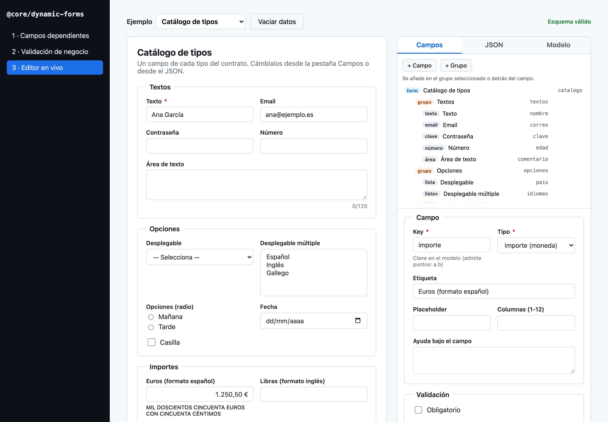

# forms-lib — @core/dynamic-forms

Angular library that renders reactive forms from JSON. A backend (or Appian) describes the form — fields, validation, conditional logic, cascading options, repeatable lists, data tables, layout — and `<dynamic-form>` renders it. Built on Angular 21 and [Formly](https://formly.dev), which stays hidden behind a stable JSON contract.

```json
{
  "version": "1.0",
  "id": "contact",
  "fields": [
    { "key": "name", "type": "text", "label": "Name", "validation": { "required": true } },
    { "key": "amount", "type": "currency", "label": "Amount", "validation": { "max": 5000 } },
    { "key": "notes", "type": "textarea", "label": "Notes", "validation": { "maxLength": 200 },
      "logic": { "showWhen": { "field": "amount", "operator": "gt", "value": 1000 } } }
  ]
}
```

```html
<dynamic-form [schema]="schema" [(model)]="model" (formSubmit)="save($event)" />
```

## Documentation

| | |
|---|---|
| [Library guide](dynamic-forms-workspace/projects/dynamic-forms/README.md) | Install, configuration, schema format (fields, groups, repeatable lists, data tables), field types, validation, conditional logic, amounts, component API, theming. |
| [Contract (`openspec.yaml`)](openspec.yaml) | The formal contract between the backend and the library. |
| [Changelog](dynamic-forms-workspace/projects/dynamic-forms/CHANGELOG.md) | Changes per version, with migration notes. |
| [Development guide](dynamic-forms-workspace/README.md) | Workspace layout, commands, tests, CI, demo and contribution rules. |

## Live editor

The demo includes a schema editor: change fields from a form or edit the JSON, and the form re-renders as you type.



## Try it

```bash
cd dynamic-forms-workspace
npm install
npm start        # http://localhost:4200
```

The demo (in Spanish) has five scenarios — dependent fields, business validation, a schema loaded from a service (simulated by a mock backend), repeatable lists with totals and data tables — and the live editor shown above at `/editor`.

## Related repositories

Depends on none of the other repositories (only Angular and ngx-formly). Used by the Angular dashboards of the project, which are not published; the server (`mediaOrquestator`) does not use it.

| Repository | What it is |
|---|---|
| [`mediaOrquestator`](https://github.com/privadosIA/mediaOrquestator) | The server: the HTTP API and its contract, the pipelines (video, images, music), the run history and the music services it starts. |
| [`heartmula`](https://github.com/privadosIA/heartmula) | C# (.NET 8 + TorchSharp) port of [heartlib](https://github.com/HeartMuLa/heartlib): the HeartMuLa song generator, run by the server as a service. |
| [`DiffRhythm2`](https://github.com/privadosIA/DiffRhythm2) | C# port of [DiffRhythm2](https://github.com/ASLP-lab/DiffRhythm2): a diffusion model that writes a whole song. |
| [`lion-clap`](https://github.com/privadosIA/lion-clap) | C# port of [LAION-CLAP](https://github.com/LAION-AI/CLAP): audio and text embeddings, used to recognise songs. |
| [`musicgen-core`](https://github.com/privadosIA/musicgen-core) | The TorchSharp building blocks shared by the three ports. |
| [`forms-lib`](https://github.com/privadosIA/forms-lib) (this repository) | `@core/dynamic-forms`, the Angular library that draws forms and tables from JSON. |

The links are to the public copies of these repositories. The third-party tools, models and libraries they build on, with their licenses, are listed in [THIRD_PARTY.md](https://github.com/privadosIA/mediaOrquestator/blob/main/THIRD_PARTY.md).

## License

[Apache-2.0](LICENSE) — Copyright (c) 2026 Jesús Suero

## Maintenance

Maintained by one person in their free time: issues and pull requests are welcome, with no promised response time. See [CONTRIBUTING.md](CONTRIBUTING.md) and, for vulnerabilities, [SECURITY.md](SECURITY.md).
